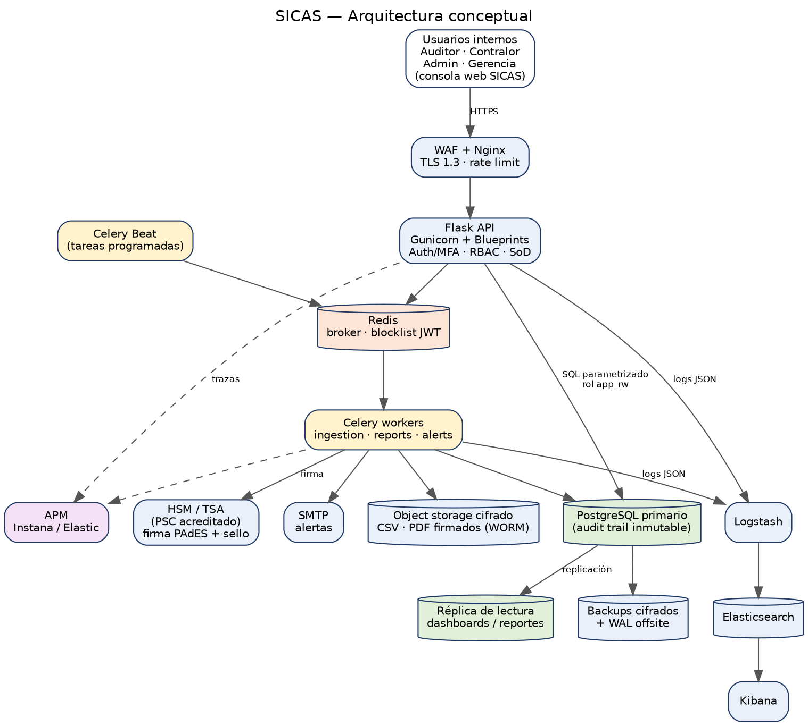

# Arquitectura de SICAS

*SICAS — Sistema Integral de Contraloría y Auditoría de Seguros*

## Vista general

*Figura 1. Arquitectura conceptual. El código fuente del diagrama (Mermaid) está en `docs/img/arquitectura.mmd`.*

## Componentes

| Componente | Responsabilidad | Decisión de diseño |
|---|---|---|
| Nginx + WAF | Terminación TLS 1.3, límites de tasa perimetrales, cabeceras | Único punto de entrada; la API no se expone directamente |
| Flask API (Gunicorn) | Endpoints REST por Blueprints, RBAC, JWT, MFA, auditoría de cada acción | Capas `api → services → repositories`; sin lógica de negocio en las vistas |
| PostgreSQL primario | Datos transaccionales, IAM, audit trail inmutable, hallazgos, informes firmados | Rol `app_rw` con mínimo privilegio; el audit trail solo admite `INSERT` |
| Réplica de lectura | Dashboards, reportes pesados, lectura del motor de reglas | Evita competir con la carga transaccional |
| Redis | Broker de Celery, lista de revocación de JWT, almacén del rate limit | Con contraseña y red privada; sin datos de negocio persistentes |
| Celery workers | Ingesta masiva, motor de reglas, generación/firma de PDF, alertas | Colas separadas (`ingestion`, `reports`, `alerts`), `acks_late`, reintentos con backoff |
| Celery Beat | Tareas programadas (verificación de cadena de hashes, respaldos, particiones) | Un único proceso Beat |
| Almacenamiento de objetos | Archivos cargados y PDFs firmados | Cifrado del lado servidor; retención tipo WORM para documentos firmados |
| HSM / TSA | Custodia de la clave de firma y sello de tiempo RFC 3161 | Certificado de un PSC acreditado (SUSCERTE) |

## Flujo principal de una auditoría

0. **Acceso.** Contraseña → MFA (TOTP) → sesión en cookies HttpOnly; los permisos viajan en el token y la firma o las acciones críticas exigen MFA reciente.
1. **Carga.** El Auditor sube un CSV (`POST /api/v1/ingestion/uploads`). La API valida formato y tamaño, calcula SHA-256 (idempotencia), guarda el archivo cifrado, registra el trabajo y responde `202`.
2. **Ingesta.** Un worker lee el archivo en *streaming*, valida y normaliza cada fila, carga por lotes a *staging*, promueve a las tablas finales en una sola transacción y **concilia** (registros, montos por moneda, hash) con tolerancia cero. Las filas rechazadas quedan trazadas.
3. **Análisis.** Al terminar la ingesta se encadena `run_anomaly_rules`. El motor ejecuta las reglas con los parámetros vigentes, guarda los hallazgos deduplicados por huella y conserva un *snapshot* de los parámetros usados.
4. **Alertas.** Los hallazgos `HIGH`/`CRITICAL` disparan correos por departamento (sin datos personales en el cuerpo).
5. **Informe.** El Auditor redacta el dictamen y lo envía; el Contralor lo aprueba (doble control: distinto del redactor). Al aprobar se fija el hash del contenido.
6. **Firma.** El Contralor, con MFA reciente, firma el PDF (PAdES) con sello de tiempo. Se registra el documento firmado y sus huellas.
7. **Verificación.** Cualquier PDF puede verificarse (integridad, cadena de confianza, sello de tiempo) y contrastarse con el registro.

## Correlación y trazabilidad

## Defensa en profundidad

| Capa | Controles |
|---|---|
| Perímetro | TLS 1.3, HSTS, límites de tasa, tamaño máximo de carga |
| Aplicación | JWT en cookie HttpOnly + CSRF de doble envío, MFA obligatorio, rate limiting, CSP estricta, validación de entrada |
| Autorización | RBAC por permisos, segregación de funciones, doble control, *step-up* de MFA para firmar |
| Datos | Consultas parametrizadas, cifrado de volumen + cifrado de columnas sensibles, roles de BD separados |
| Trazabilidad | Audit trail con hash encadenado, triggers de inmutabilidad, verificación periódica, export a almacén inmutable |
